```{r setup_theme, include = FALSE}

light_color <- 'white'
text_color <- '#397CDA'
gray <- "#333333"
blue <- "#4466B0"


library(xaringanthemer)
style_duo(
  # colors
  primary_color = light_color,
  secondary_color = text_color,
  header_color = light_color,
  text_color = text_color,
  code_inline_color = colorspace::lighten(text_color),
  text_bold_color = colorspace::lighten(text_color),
  link_color = text_color,
  title_slide_text_color = text_color,
  background_position = 'center',
  header_font_google = google_font("Lato"),
  text_font_google   = google_font("Lato", "300", "300i"),
  code_font_google   = google_font("Hack"),
  code_highlight_color = 'rgba(58,116,188,0.15)',
  code_font_size = '50%',
  padding = "0.4em 2.4em 0.4em 2.4em",
  extra_fonts = list(google_font("Lato")),
  extra_css = 
  list(
  ".red"    = list(color = "red"),
  ".white"  = list(color = "white"),
  ".bold_white" = list(color = "white", "font-weight" = "bold"),
  ".small" = list("font-size" = "90%"),
  ".pull_l_70"  = list("float" = "left" , "width" = "72%"),
  ".pull_r_30"  = list("float" = "right", "width" = "23%"),
  ".pull_l_60"  = list("float" = "left" , "width" = "60%"),  
  ".pull_r_40"  = list("float" = "right", "width" = "33%"),
  ".pull_l_50"  = list("float" = "left" , "width" = "45%"),
  ".pull_r_50"    = list("fixed" = "right", "width" = "45%"),
  ".small_left"  = list("float" = "left", "width" = "47%", "height" = "50%", "padding-right" = "2%"),
  ".small_right" = list("float" = "right","width" = "47%", "height" = "50%", "padding-left"  = "2%"),
  ".left_code" = list("float" = "left",  "width" = "47%", "height" = "100%", "padding-right" = "2%",
    "font" = "Hack"),
  ".code_out"  = list("float" = "right", "width" = "47%", "height" = "100%", "padding-left"  = "2%",
    "font" = "Hack"),
  ".pull_l_50_1" = list(
    display = "flex",
    width   = "100%",
    height   = "77%",
    "flex-flow" = "column wrap",
    flex    = "1",
    "padding-left"  = "10%"
  ),
  ".pull_l_50_2" = list(
    display = "flex",
    width   = "100%",
    height   = "10%",
    "flex-flow" = "column wrap",
    flex    = "2",
    "padding-left"  = "10%"
  ),  
  ".text_250" = list("font-size" = "250%"),
  ".text_240" = list("font-size" = "240%"),
  ".text_230" = list("font-size" = "230%"),
  ".text_220" = list("font-size" = "220%"),
  ".text_210" = list("font-size" = "210%"),
  ".text_200" = list("font-size" = "200%"),
  ".text_190" = list("font-size" = "190%"),
  ".text_180" = list("font-size" = "180%"),
  ".text_170" = list("font-size" = "170%"),
  ".text_160" = list("font-size" = "160%"),    
  ".text_150" = list("font-size" = "150%"),
  ".text_140" = list("font-size" = "140%"),  
  ".text_130" = list("font-size" = "130%"),
  ".text_120" = list("font-size" = "120%"),
  ".text_110" = list("font-size" = "110%"),
  ".text_110" = list("font-size" = "110%"),
  ".text_100" = list("font-size" = "100%"),
  ".text_90" = list("font-size" = "90%"),
  ".text_80" = list("font-size" = "80%"),
  ".text_70" = list("font-size" = "70%"),
  ".text_60" = list("font-size" = "60%"),
  ".text_50" = list("font-size" = "50%"),
  ".text_40" = list("font-size" = "40%"),
  ".text_30" = list("font-size" = "30%"),
  ".text_20" = list("font-size" = "20%"),
  ".line_space_11" = list("line-height" = "1.1em;"),
  ".line_space_09" = list("line-height" = "0.9em;"),
  ".line_space_07" = list("line-height" = "0.7em;"),
  ".line_space_05" = list("line-height" = "0.5em;"),
  ".line_space_04" = list("line-height" = "0.4em;"),
  ".line_space_03" = list("line-height" = "0.3em;"),
  ".line_space_02" = list("line-height" = "0.2em;"),
  ".line_space_01" = list("line-height" = "0.1em;"),
    ".french" = list(
      "text-indent" = "-30px", 
      "position"= "absolute%",
      "padding-left"= "40px%"
      ),

    ".tiny_text" = list(
      "font-family" = "Lato", 
      "font-size"= "70%"
      ),
    ".large_text" = list(
      "font-family" = "Lato", 
      "font-size"= "150%"
      ),
    ".slide_blue" = list(
      "background-color" = "#397CDA",
      "color" = "white"
      ),
  ".center_image" = list(
    margin  = "0",
    position = "absolute",
    top      = "50%",
    left     = "50%",
    '-ms-transform' = "translate(-50%, -50%)",
    transform = "translate(-50%, -50%)"
    ),
  ".hljs-github .hljs" = list(
    background = 'rgba(58,116,188,0.03)')
  )
)


# 'rgba(25,142,255,0.3)',

knitr::opts_chunk$set(comment = NA)
knitr::opts_chunk$set(dpi=1500)

# preview slides
# xaringan::inf_mr('psi2301_slide_example.rmd')


# padding-top: 0.4em;
# padding-right: 2.4em;
# padding-bottom: 0.4em;
# padding-left: 2.4em;

```
class: title-slide, middle, center

background-image: url(img/mide_logo_2019.png), url(img/coes.png)
background-position: top left, top right
background-size: 15%, 10%

```{r echo=FALSE, out.width = '2%', out.height = '2%'}

```

<br>

.line_space_07[
## .text_70[Youth dispositions to participate in disruptive and pacific actions:]  
### .text_70[gaps across countries and years.]
]
<br>

.line_space_03[
.blue[

.text_80[

.text_70[**Daniel Miranda. Contact**: **damiran1@uc.cl**]

.text_70[**Measurement Center MIDE UC, Pontificia Universidad Católica de Chile**]

.text_70[**Centro de Estudios de Conflicto y Cohesión Social - COES**]

<br>


.text_70[**Juan Carlos Castillo**]

.text_70[**School of Sociology, Universidad de Chile**]

.text_70[**Centro de Estudios de Conflicto y Cohesión Social - COES**]


]

<br>

.line_space_02[
.text_60[**Funding Project ANID/FONDECYT/11190508**]

.text_60[**Funding Project ANID/FONDECYT/11190508**]
]

<br>

.text_60[**VII Seminar "INVALSI data: a tool for teaching and scientific research"**]

.text_70[Rome. Italy - October 28, 2022]
]
]

---
**Research Program on School Citizenship PRICE**

```{r, echo=FALSE, out.width = '30%', fig.retina = 1, fig.align='center'}
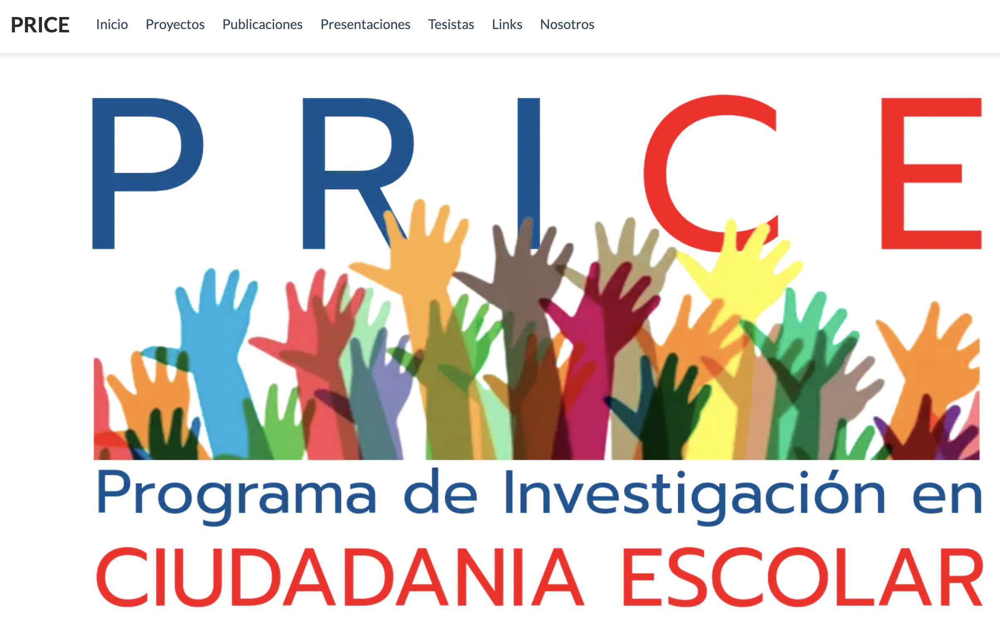
```

 .text_70[
**url:** [https://ciudadania-escolar.cl/](https://ciudadania-escolar.cl/)
  ]

- Proyecto FONDECYT de regular 1210847 (2021-2024): **Moral foundations of the educational market and its implications for citizenship education in Chile**. Investigador principal: Juan Carlos Castillo <br> 

- Proyecto FONDECYT de Iniciación 11221143 (2022-2024): **Political socialization and citizenship education in Chile: a study on gender differences, gaps and biases in the school context**. Investigador principal: Camila Jara <br> 

- Proyecto FONDECYT de Iniciación 11190508 (2019-2022): **Youth citizen participation: between reproduction and political socialization**. Investigador principal: Daniel Miranda <br>

- Proyecto FONDECYT de regular 1181239 (2019-2022): **Political socialization and education for citizenship: the role of the family and the school**. Investigador principal: Cristián Cox <br>

- Proyecto FONDECYT de regular 1120630 (2012-2015): **Political socialization and school experience - Chile in international context**. Investigador principal: Cristián Cox <br>

---
**Research Program on School Citizenship PRICE**

```{r, echo=FALSE, out.width = '70%', fig.retina = 1, fig.align='center'}
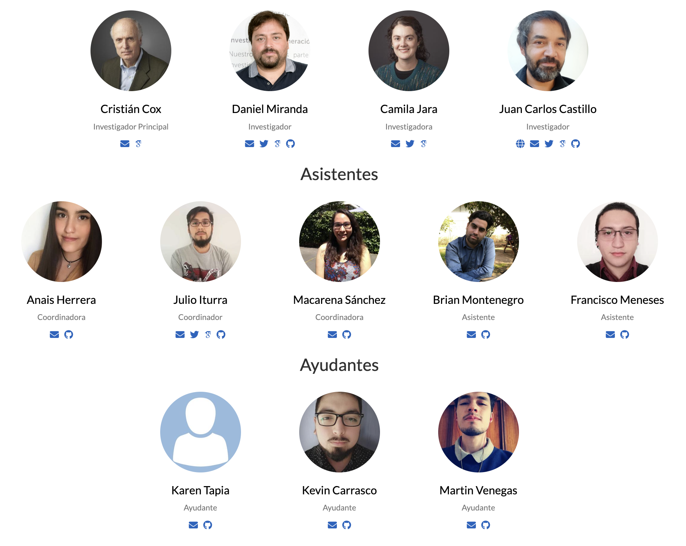
```

---
**Introduction**

- The age os mass movilization?

```{r, echo=FALSE, out.width = '60%', fig.retina = 1, fig.align='center'}
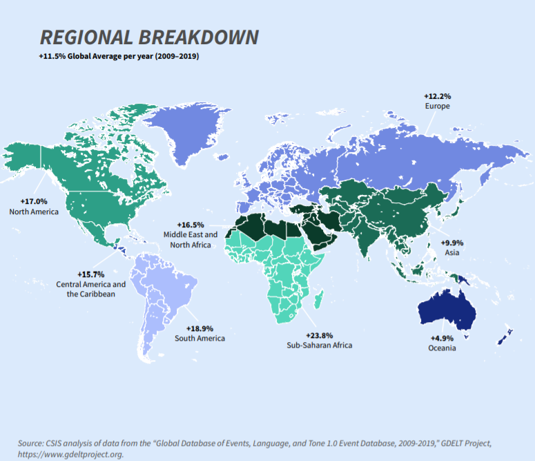
```

---
**Introduction**

- Young people and protest as an old and new phenomenon

```{r, echo=FALSE, out.width = '100%', fig.retina = 1, fig.align='center'}
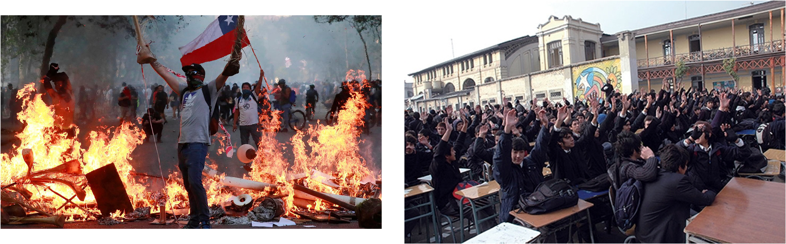
```


- Scarce knowlege about causes and consequences, for next generations and institutions


---
**Introduction**

Contextual explanantion: inequalities

- Some relevant literature agrees inequality has potential to influence protest, but it is unclear how differ the effect when different types of participation are considered. 

- Additionally, how it's related with protest of young popullation still being a unclear topic.


Individuals explanation of participation
- Resorces Model of participation: unequal access to political voice

- Civic or political knowledge it's considered a cornerstone of political involvement

- Gender differences

---
**Objectives**

This study aims:

- To assess gaps regarding adolescents' willingness to participate in radical and pacific forms of political actions, analyzing the willingness of adolescents to participate in various forms of radical political participation and comparing the differences between countries and over time.

- To evaluate the role of inequality conditions (measured as Gini index) to explain the differences in the dispositions of these forms of political action among countries.

- To evaluate the role of individual characteristics (parent's education, civic knowledge and gender) to explain the differences in the dispositions of these forms of political action among countries.


---
**Data**

- National representative samples using International Civic and Citizenship Study ICCS, 2009 and 2016.

  + ICCS 2009: 38 countries
  + ICCS 2016: 24 countries

- National representative samples using CIVED 1999

  + CIVED 1999: 28 countries
  
- This study pretend to combine the three studies.


---
**Measures of participation available on the three IEA studies**

There are many different ways how citizens may express their opinions about important issues in society. Would you take part in any of the following activities to express your opinion in the future? 

*Disposition to pacific actions*
- Contact al elected representative
- Take part in a peaceful march or rally
- Collect signatures for a petition

*Disposition to radical or disruptive actions*
- Spray-paint protest slogans on walls
- Stage a protest by clocking traffic
- Occpy public buldings as a sign of protest

*Response scale*
    + 1-I would certainly not do this
    + 2-I probably not do this
    + 3-I would probably do this
    + 4-I would certainly do this

---
**Independent Variables measures**

- Gini Index: obtained from the Standadized World Income Inequality Database (https://fsolt.org/swiid/). 

- Parents educational level: the highest level recoded as 0 *Non univerity* and 1 *University*

- Civic knowledge: One plasible value in ICCS 2009 and 2016. In CIVED 1999 were used the provided scale.

- Sex of the student.


---
**Analyses **

A set of descriptive analyses were connducted to undertand patterns

A set o f multilevel models were conducted to estimate the effect of contextual and individual variables

Graphics representation of results

---
**Levels of dispositions across studies**

```{r, echo=FALSE, out.width = '71%', fig.retina = 1, fig.align='center'}
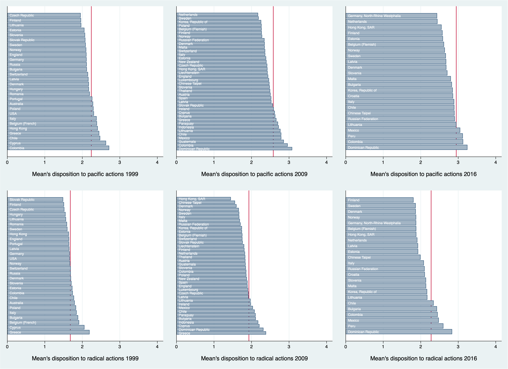
```
---
**Inequality and dispositions**

```{r, echo=FALSE, out.width = '100%', fig.retina = 1, fig.align='center'}
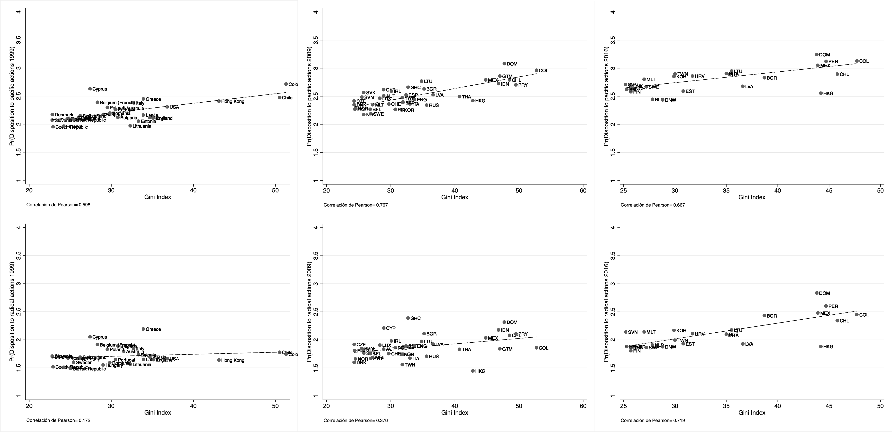
```


---
**Results on ICCS 2016**

```{r, echo=FALSE, out.width = '110%', fig.retina = 1, fig.align='center'}
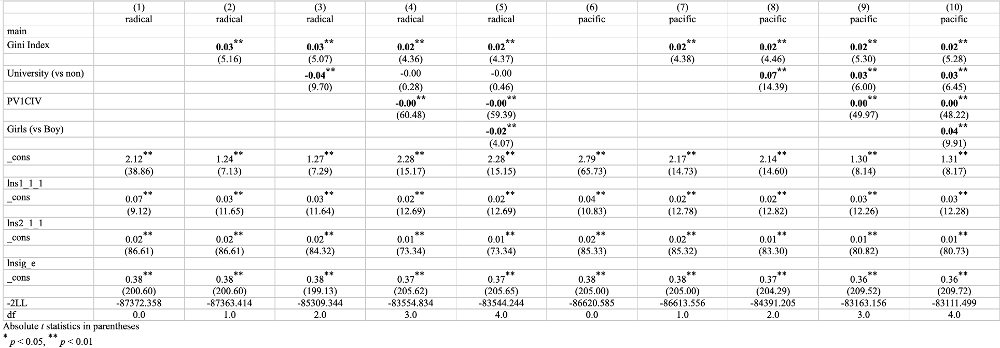
```

---
**Gini effect on disposition to pacific and radical**

```{r, echo=FALSE, out.width = '110%', fig.retina = 1, fig.align='center'}
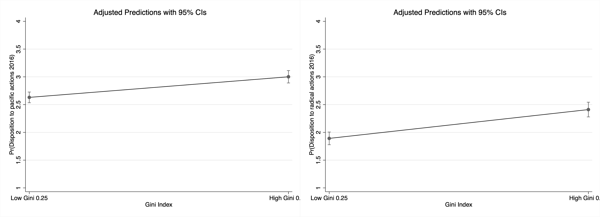
```


---
**Civic Knowledge effect on disposition to pacific and radical**

```{r, echo=FALSE, out.width = '110%', fig.retina = 1, fig.align='center'}
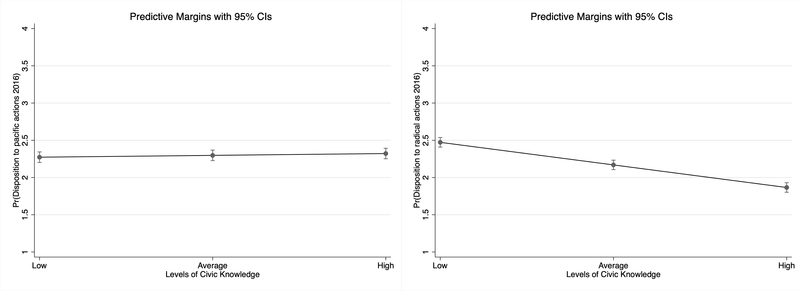
```


---
**Results on ICCS 2009**

```{r, echo=FALSE, out.width = '110%', fig.retina = 1, fig.align='center'}
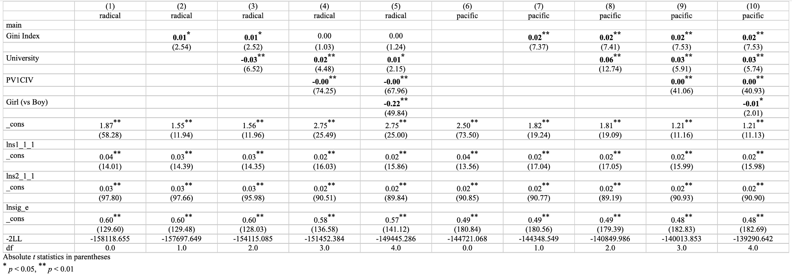
```

---
**Gini effect on disposition to pacific and radical**

```{r, echo=FALSE, out.width = '110%', fig.retina = 1, fig.align='center'}
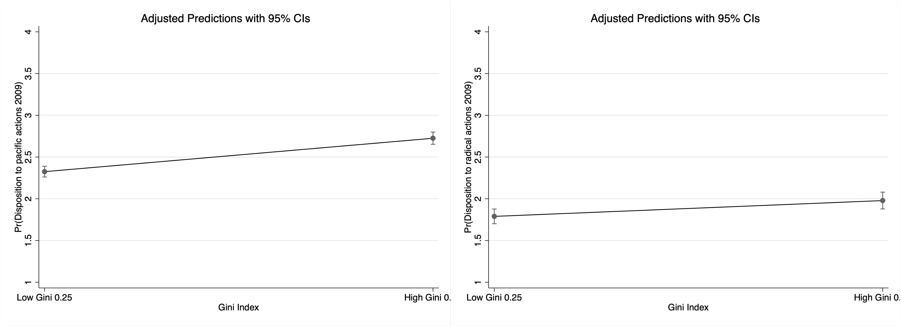
```


---
**Civic Knowledge effect on disposition to pacific and radical**

```{r, echo=FALSE, out.width = '110%', fig.retina = 1, fig.align='center'}
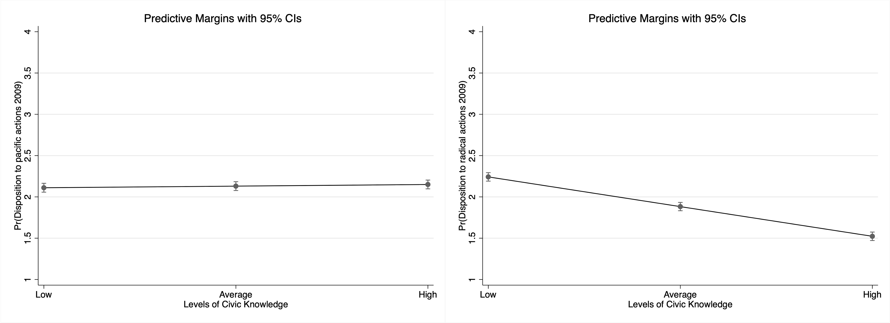
```

---
**Results on CIVED 1999**

```{r, echo=FALSE, out.width = '110%', fig.retina = 1, fig.align='center'}
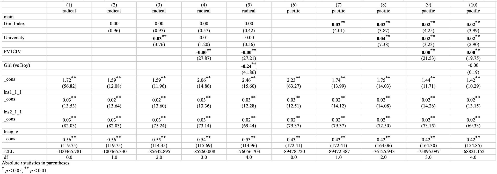
```

---
**Gini effect on disposition to pacific and radical**

```{r, echo=FALSE, out.width = '110%', fig.retina = 1, fig.align='center'}
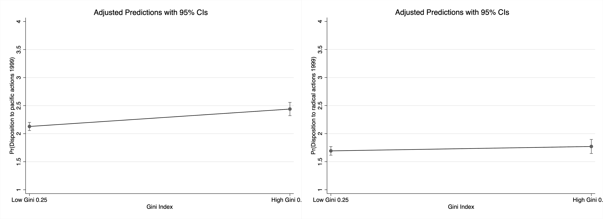
```


---
**Civic Knowledge effect on disposition to pacific and radical**

```{r, echo=FALSE, out.width = '110%', fig.retina = 1, fig.align='center'}
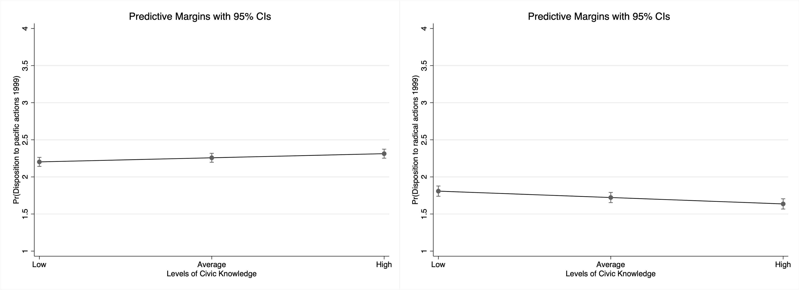
```


---
**Discussion**

General patterns
- Student are more willing to participate in pacific than in radical actions.
- Both types of willingness tend to increse between 1999, 2009 and 2016.
- Latin American countries tend to be in top of the list in both types of participation.

Unequal context
- In more unequal contexts students tend to show higher disposition to participate in pacific actions. This results appear in 1999, 2009 and 2016.
- For the case of radicala actions, seems to unequal context matter in recent years but less in previuos cohorts.
- This results support the idea that inequalities generate more conflicts inn the society.

---
**Discussion**

Individual characteristics.
- Civic knowledge show a relevant role: tend to increse participation in pacific action and decrese participation in radical actions. 
- Resources matters in two ways: intergenerational transmission of civic skills.
- Gender differences: girls tend to show lower dispositions than boys for radical actions but the differences seems to be shortened across time.

Next steps
- Combine the data: there are some challenges about homologation of Civic Knowledge scale.

---
class: title-slide, middle, center

background-image: url(img/mide_logo_2019.png), url(img/coes.png)
background-position: top left, top right
background-size: 15%, 10%

```{r echo=FALSE, out.width = '2%', out.height = '2%'}

```

**¡Muchas gracias por su atención!**

<br>

.line_space_07[
## .text_70[Youth dispositions to participate in disruptive and pacific actions:]  
### .text_70[gaps across countries and years.]
]
<br>

.line_space_03[
.blue[

.text_70[

.text_70[**Daniel Miranda. Contact**: **damiran1@uc.cl**]

.text_70[**Measurement Center MIDE UC, Pontificia Universidad Católica de Chile**]

.text_70[**Centro de Estudios de Conflicto y Cohesión Social - COES**]

<br>


.text_70[**Juan Carlos Castillo**]

.text_70[**School of Sociology, Universidad de Chile**]

.text_70[**Centro de Estudios de Conflicto y Cohesión Social - COES**]


]

<br>

.line_space_02[
.text_60[**Funding Project ANID/FONDECYT/11190508**]

.text_60[**Funding Project ANID/FONDECYT/11190508**]
]

<br>

.text_60[**VII Seminar "INVALSI data: a tool for teaching and scientific research"**]

.text_70[Rome. Italy - October 28, 2022]
]
]

<br>
